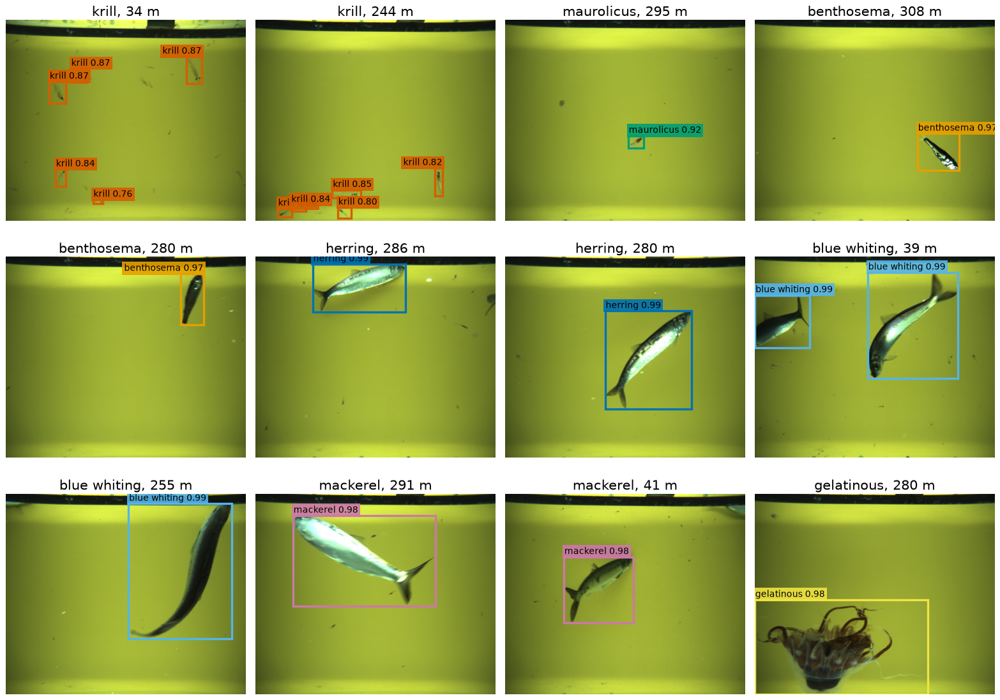
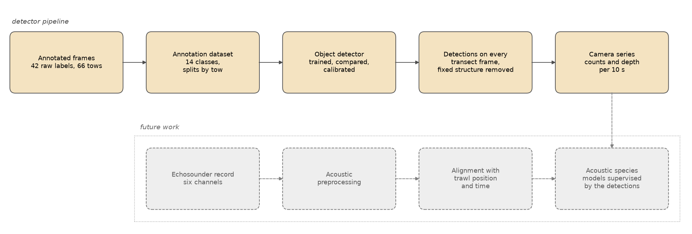
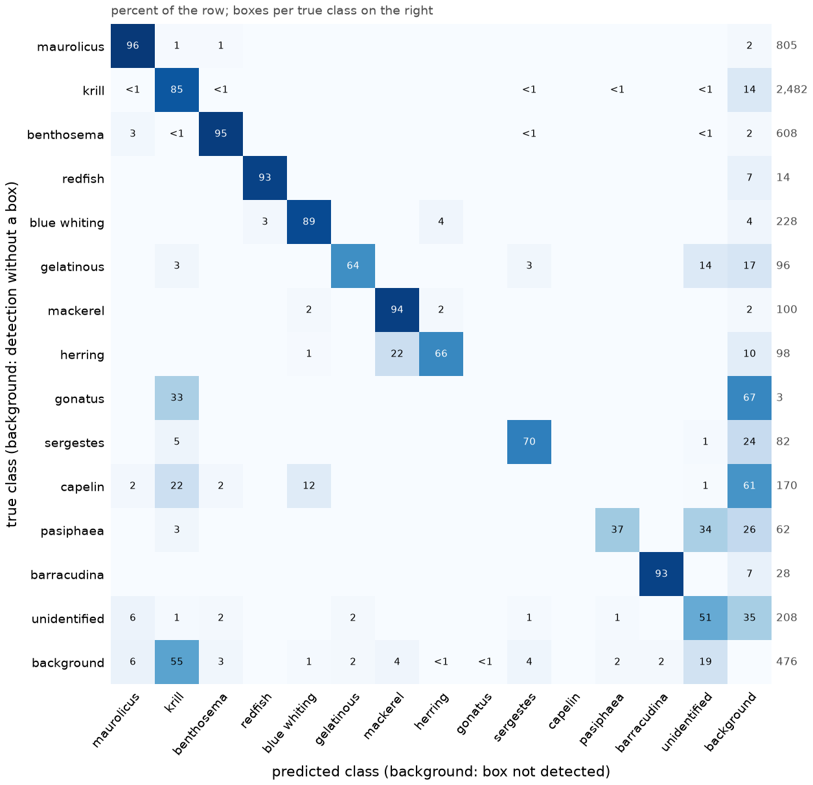
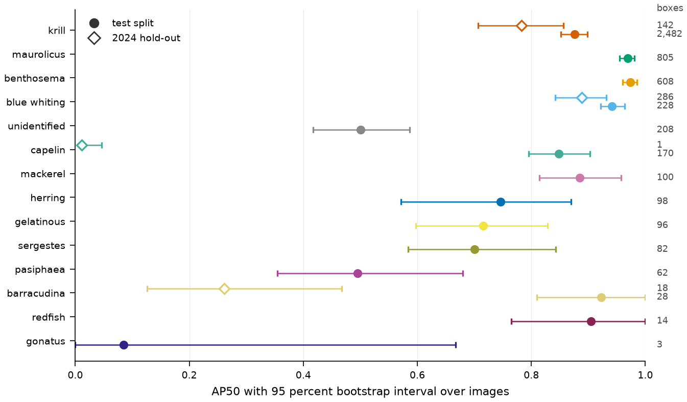
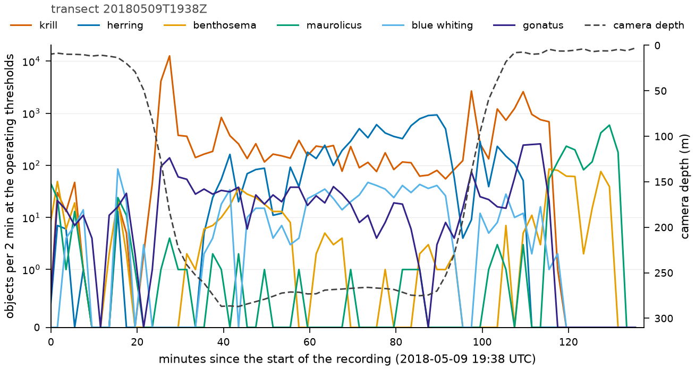

# Species detection in in-trawl camera imagery

A detector for the imagery of the Deep Vision in-trawl camera finds and names thirteen taxa in every frame, from krill a few dozen pixels wide to herring that span half a frame. Its confidence is calibrated, and each class has an operating threshold. The pipeline around it builds the annotation dataset with splits by tow, compares detector families, and turns every frame of a survey transect into counts per species and a camera depth at ten-second resolution.

This work grew out of the master's thesis *Visual Transformers for Integrating Deep Vision and Acoustic Data* (Applied and Computational Mathematics, University of Bergen, 2025).



*Frames from the 2018 transects with the detections of the selected detector. Each label gives the class and the calibrated confidence; each frame title gives the class shown and the camera depth.*

## Purpose

The Deep Vision camera photographs organisms as they pass through a trawl, five frames per second and about 36,000 frames in a two-hour tow. Reading the frames by eye does not scale to a survey, so what they record about which species occupied which depth stays unused. The detector turns them into counted detections per class with confidences that can be read as probabilities, on tows from a year with few annotations. Such counts give the echosounder, which sees every scatterer but names none, a co-located source of species labels.

## Approach



*The pipeline. The detector stages are in colour; the acoustic integration is in grey.*

Images and annotation files are paired by relative path, and 42 raw labels are mapped to thirteen classes and one class for unidentified objects. Whole tows are assigned to training, validation and test by a seeded search that balances classes and years; all 2024 material is held out. RT-DETRv2-L, D-FINE-L and a RetinaNet reference are trained under one recipe at 1,024 pixels and scored by the same code with bootstrap intervals over images. Confidence is calibrated by Platt scaling on the validation split, and each class receives the threshold that maximises its F1 there. The selected detector runs on every frame of four transects; boxes of fixed structure such as the camera housing are removed, and frames and detections are aggregated to ten-second intervals with the cleaned camera depth. `docs/methods.md` describes every step.

## Results

The selected detector is RT-DETRv2-L at 1,024 pixels. Macro mAP50 is the mean over the classes with at least ten boxes in the slice, with 95 percent bootstrap intervals over images; mAP50:95 is the COCO metric over all classes.

| Slice | Images | Macro mAP50 | mAP50:95 |
|---|---|---|---|
| Test tows, all years | 1,240 | 0.806 [0.785, 0.840] | 0.502 |
| Test tows, 2018 stations | 59 | 0.962 [0.906, 0.992] | 0.603 |
| 2024 hold-out tow | 130 | 0.644 [0.600, 0.743] | 0.264 |

Three seeds give a test macro mAP50 of 0.806, 0.797 and 0.805. The choice between the two transformers used the test split, so its test figures carry a selection bias; the 2024 hold-out did not enter the choice. On the four transects the detector processed 141,727 frames at 62 frames per second on one A100, limited by JPEG decoding, and counted 261,159 objects at the operating thresholds after the removal of fixed structure.



*Confusion matrix on the test split, in percent of each true class. The background row holds detections that match no box, and the background column holds boxes that were not detected.*



*AP50 per class on the test split (filled circles) and on the 2024 hold-out (open diamonds), with 95 percent bootstrap intervals. The numbers on the right are the boxes per class.*



*Objects per two minutes along transect 20180509T1938Z, with the camera depth on the right axis. Krill dominates the descent and the ascent, herring the layer at 250 to 300 m.*

`docs/results.md` holds every table and figure.


## Reproducing

```bash
conda env create -f environment-laptop.yml
conda activate acoustic-cpu
pip install -e .
pytest -q
```

The stages run on a server that holds the raw data, in the environment of `environment-server.yml`. Each stage is one `echolabel` command, from `build-annotation-dataset` and `train-detector` to `infer-transect` and `build-camera-series`, and reads a stage configuration from `configs/` and a paths file for the machine. One detector run takes five to seven hours on one A100 and the transect inference 40 minutes. The figures are drawn from the result tables and the stored detections by the scripts under `scripts/`. `docs/reproducibility.md` gives the exact commands, machines, runtimes and seeds, and how to verify the tables in `results/` against their manifests.

## Repository layout and licence

```
configs/            stage configurations, taxonomy, splits and machine-specific path files
src/echolabel/      package: data readers, detection, transect inference, camera series, and the acoustic infrastructure
scripts/            launchers for the compute server, syncing, verification, the figures
tests/              unit tests on synthetic data
docs/               data description, methods, results, reproducibility, figures
results/            small result tables and figures with their manifests
```

The code is released under the MIT licence (`LICENSE`). The detector frameworks are separate projects under their own licences, named in `docs/methods.md`. The survey data are not distributed with the repository.
