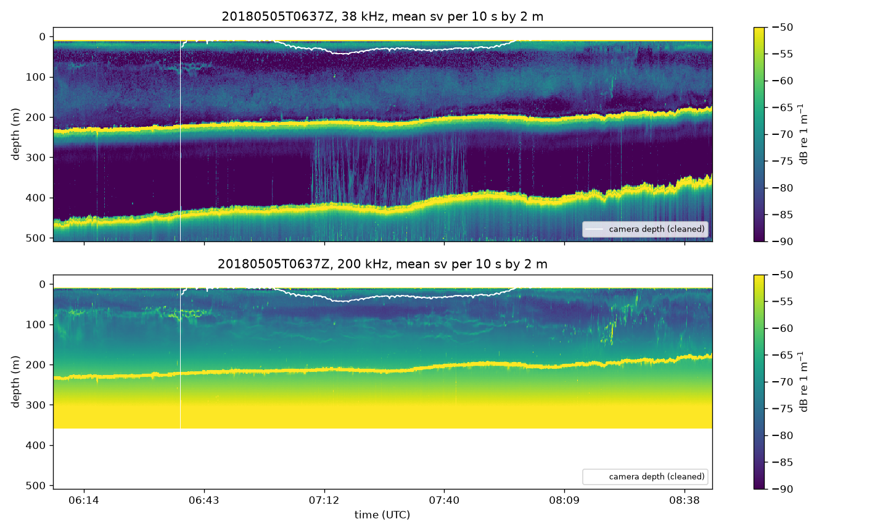
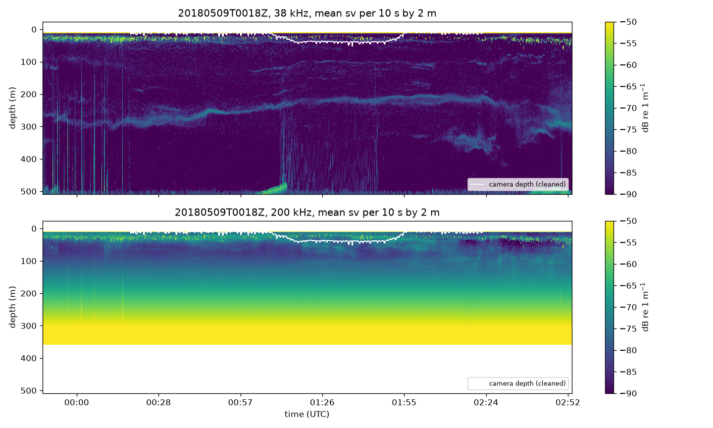
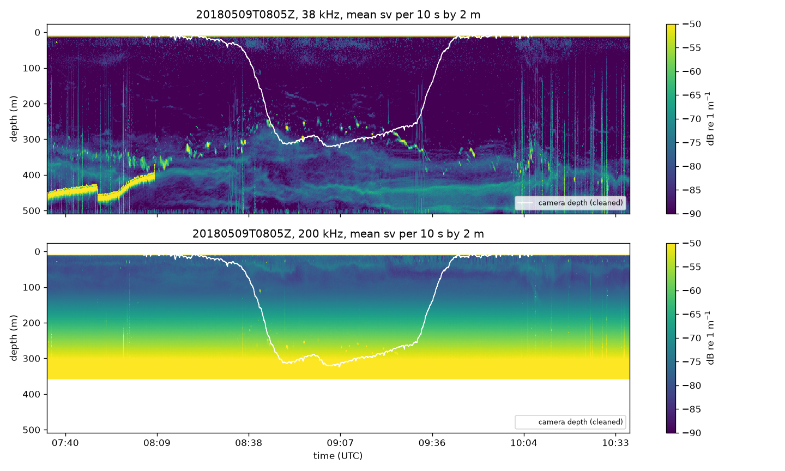
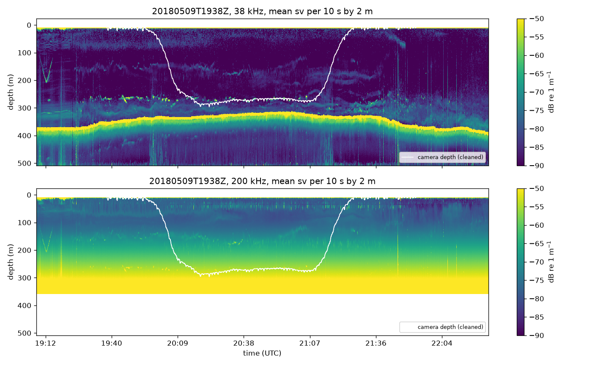

# Data

The raw data sources are described as the audit stage found them; the tables behind the numbers are in `results/audit/`. Paths are relative to the two roots named in the paths file of the server (`configs/paths/server.example.yaml`): `source_data` holds the acoustic store and the camera transects, `annotated_data` holds the annotation collection.

## 1. Overview

Three sources are used.

| Source | Content | Size | Role |
|---|---|---|---|
| `S2018105_sv.zarr` | Multi-frequency echosounder backscatter for one survey cruise, 30 April to 31 May 2018 | 290 GB, 9,121 files | Echosounder record of the cruise, input of the acoustic infrastructure |
| Four 2018 camera transects | Stereo trawl camera frames and per-frame metadata, 5 and 9 May 2018 | 58 GB, 283,000 files | Detector inference |
| Annotation collection | Camera frames with hand-drawn bounding boxes, 2017 to 2024 | 29 GB, 31,019 files | Detector training and evaluation |

Two further camera transects from November 2024 (20 GB) have no matching acoustic data and serve only to test the detector on a different year and camera.

## 2. Echosounder backscatter

### 2.1 Instrument and processing

The store holds the volume backscattering coefficient `sv` (linear units, 1/m) from a six-channel Simrad EK80 system with wideband transceivers. Channel identifiers and nominal frequencies are:

| Position in store | Channel identifier | Frequency |
|---|---|---|
| 0 | WBT 714596-15 ES38-7 | 38 kHz |
| 1 | WBT 714581-15 ES18 | 18 kHz |
| 2 | WBT 714590-15 ES70-7C | 70 kHz |
| 3 | WBT 714583-15 ES120-7C | 120 kHz |
| 4 | WBT 714605-15 ES200-7C | 200 kHz |
| 5 | WBT 714597-15 ES333-7C | 333 kHz |

The frequency coordinate is not stored in ascending order. The frequency parsed from each channel identifier agrees with the frequency coordinate at every position. All code selects channels by frequency value.

The store was produced by the KORONA processing software (version 2.15.0) from 10,792 raw files of about four minutes each. It is a Zarr version 2 group. The array `sv` has shape (6 frequencies, 2,370,877 pings, 2,500 range samples), type float32, chunks of (1, 10,000, 2,500) compressed with Blosc and zstd. Two arrays of split-beam angles with the same shape are present and are not used. Missing values are stored as NaN; there are no zero or negative values.

### 2.2 Coordinates

- `ping_time`: UTC, millisecond resolution, from 2018-04-30 20:02:49 to 2018-05-31 16:02:31. Strictly increasing. The median ping interval is 0.94 s (1st to 99th percentile 0.80 to 4.36 s). Twenty gaps exceed one minute; the longest, from 22 May 05:48 to 23 May 14:10, lasts 32 hours. During the four camera transects the median interval is 0.92, 1.06, 1.42 and 0.96 s and no gap exceeds 21 s.
- `range`: 0 to 499.8 m in 2,500 steps of 0.2 m, measured from the transducer face.
- `latitude`, `longitude`: complete for every ping; the cruise covers 60.4 to 72.4 degrees north and 14.0 degrees west to 20.2 degrees east. Vessel speed derived from position during the camera transects is 1.6 to 1.8 m/s (median), about 3.3 knots.
- `transducer_draft`: 6.0 m until 2018-05-01 12:35, 8.5 m until 2018-05-31 14:56, then 6.0 m again, identical for all channels. All four camera transects fall in the 8.5 m period. Depth below the surface is range plus draft.
- `pulse_length`: 1.024 ms for all channels during the transects except 200 kHz, which used 2.048 ms. The 18, 38 and 70 kHz channels kept 1.024 ms for the whole cruise. The 120 kHz channel used 2.048 ms from 1 May 11:33 to 3 May 10:44 and 4.096 ms in three periods after 10 May. The 200 kHz channel used 2.048 ms from 1 May 11:33 onwards, with 8.192 ms in periods on 5, 7 and 10 May and afterwards. The 333 kHz channel used 2.048 ms for seven hours on 1 May and 1.024 ms otherwise. The pulse length sets the range resolution and the receiver bandwidth, so the noise level per channel changes with it.
- `heading`, `pitch`, `roll`, `heave`, `distance`, `raw_file`: present per ping; none of the arrays carries unit attributes.

### 2.3 Missing values and usable range

| Frequency | Missing fraction | Last range with under half of pings missing | Pings entirely missing |
|---|---|---|---|
| 18 kHz | 0.44 % | 499.8 m | 10,394 |
| 38 kHz | 0 | 499.8 m | 0 |
| 70 kHz | 0 | 499.8 m | 0 |
| 120 kHz | 19.3 % | 399.8 m | 0 |
| 200 kHz | 28.9 % | 348.4 m | 0 |
| 333 kHz | 54.3 % | 199.6 m | 0 |

The 18 kHz channel lacks exactly one ping about every 3.7 minutes, one per raw file, which gives 24 to 37 missing pings per transect. The three highest frequencies are blanked beyond a frequency-dependent range by the processing software. Camera depths reach 360 m, so the 333 kHz channel does not cover the deeper part of two transects and the 200 kHz channel only partly.

### 2.4 Value distribution

Expressed in decibels (10 log10 sv), the median value over the whole store is between -89 and -83 dB at 18 to 120 kHz and -67 to -71 dB at 200 and 333 kHz. At 38 kHz, 45 % of samples lie at or below -90 dB and 21 % at or below -100 dB. The two highest frequencies are dominated by range-amplified noise beyond about 100 m: their fraction of samples at or below -90 dB is below 3 % overall, against 32 to 45 % for the lower channels. Per-frequency histograms and per-range profiles are in `results/audit/zarr/`.

### 2.5 Backscatter around the camera transects

Figures 1 to 4 show coarse echograms of the four transect windows (mean sv per 10 s by 2 m) at 38 and 200 kHz, with the cleaned camera depth drawn on top. The per-range quantiles behind the statements below are in `results/acoustics/exploration/range_profiles_1m.csv`, a copy of the stage output `range_profiles.csv` reduced to every fifth range sample (1 m) and rounded to 0.01 dB.

*Figure 1. Echogram of the window around transect 20180505T0637Z at 38 kHz (top) and 200 kHz (bottom), with the cleaned camera depth as a white line. The camera stays in the upper 50 m. The seabed at 180 to 230 m and its first multiple at twice that range are the two bright bands.*

*Figure 2. Echogram of the window around transect 20180509T0018Z. The camera stays in the upper 40 m while a scattering layer rises from 280 to 220 m during the night. No seabed is within range.*

*Figure 3. Echogram of the window around transect 20180509T0805Z. The camera descends through dense schools at 250 to 350 m. The seabed is at 440 to 460 m at the start and deepens beyond the range later.*

*Figure 4. Echogram of the window around transect 20180509T1938Z. The camera follows a layer at 250 to 300 m, 30 to 60 m above the seabed. At 200 kHz the noise that rises with range hides everything beyond about 150 m, and the channel is blanked beyond 350 m.*

- **Seabed.** Transect 20180505T0637Z runs over a shelf with the seabed at 180 to 230 m, and its first multiple appears at about twice that range. Transect 20180509T1938Z has the seabed at about 325 m, with the camera towed 30 to 60 m above it. In 20180509T0805Z the seabed is at 440 to 460 m at the start and deepens beyond the 500 m range later. No seabed is within range in 20180509T0018Z. At 38 kHz the seabed echo exceeds -10 dB and is found as the strongest return beyond 50 m in more than 99 percent of pings where it is in range.
- **Near-surface ringdown.** The 18 kHz channel is dominated by transducer ringdown down to about 50 m (median -73 dB at 15 m, -83 dB at 50 m, below -90 dB from 100 m). The other channels are affected within the first 10 to 15 m below the transducer.
- **Noise with range.** At 200 kHz the median level rises from -78 dB at 100 m to -63 dB at 200 m and -49 dB at 300 m in every window. At 333 kHz it rises from -75 dB at 100 m to -54 dB at 200 m. The time-varied gain amplifies a constant noise power, so these channels carry no information about scatterers beyond roughly 150 and 100 m. At 120 kHz the same effect appears mildly beyond 250 m; 18, 38 and 70 kHz keep a floor near -100 dB to the end of the range.
- **Impulsive noise.** Pings whose mean level between 50 and 400 m at 38 kHz jumps above the local median by five robust scales make up 0.3 to 2.2 percent of the pings per window. They show as vertical stripes in the echograms, mostly in the deeper half of the water column.
- **Scattering layers.** Each window shows layers at 38 kHz. In 20180509T0018Z a night-time layer rises from 280 to 220 m while the camera stays in the upper 40 m. In 20180509T0805Z the camera passes through dense schools at 250 to 350 m. In 20180509T1938Z the camera follows a layer at 150 to 200 m and a dense layer at 250 to 300 m.

## 3. Camera transects, 2018

### 3.1 Layout

Each transect directory holds `Left/` and `Right/` camera trees, a binary calibration file `calib` (26 MB) and `deepvision.xml`. Each camera tree holds subfolders named by start time, in pairs `HHMMSSZ_active` and `HHMMSSZ_empty`. Every `_active` folder holds 2,000 JPEG frames except the last of each transect; every `_empty` folder is an empty directory. Frames are named by their UTC timestamp with millisecond resolution, `YYYYMMDDhhmmssSSS.jpg`, and measure 1,228 by 1,027 pixels. Left and right trees hold the same number of frames with identical timestamps. Frame files are 30 to 610 kB, median about 200 kB.

| Transect | Frames per camera | Start (UTC) | End (UTC) | Duration | Camera depth, median (95th percentile, maximum) |
|---|---|---|---|---|---|
| 20180505T0637Z | 28,683 | 2018-05-05 06:37:56 | 08:14:53 | 1 h 37 min | 27 m (54 m, 85 m) |
| 20180509T0018Z | 36,743 | 2018-05-09 00:18:55 | 02:23:08 | 2 h 04 min | 22 m (54 m, 100 m) |
| 20180509T0805Z | 36,183 | 2018-05-09 08:05:32 | 10:07:51 | 2 h 02 min | 88 m (318 m, 359 m) |
| 20180509T1938Z | 40,118 | 2018-05-09 19:38:34 | 21:54:10 | 2 h 16 min | 224 m (289 m, 321 m) |

Frames arrive every 0.203 s (4.9 per second) with no gap above one second and no duplicate or out-of-order timestamps.

### 3.2 Metadata

The depth readings carry an artefact. About one reading in three departs from the smooth trajectory to a deeper value, by 13 m in the median and regardless of depth, for a single sensor update of about 0.6 s before returning. Departures to shallower values are far fewer and smaller. The pattern is consistent with a telemetry artefact. `deepvision.xml` lists one `frame` record per frame with the attributes `time`, `depth`, `id`, `folder`, `lat`, `lon` and `active`; the last transect also has `voltage`, `temp`, `pitch` and `roll`. The header names the camera system DV0001 and leaves vessel, cruise and station fields unfilled. Latitude and longitude are zero throughout; position comes from the echosounder navigation instead. All frames are flagged active.

Metadata records are joined to frames by timestamp. Every transect has exactly one frame, the last one, without a record, and no record without a frame. Folder names in the records agree with the folder each frame sits in.

Depth is reported in metres with one decimal. In three transects (20180505T0637Z, 20180509T0018Z, 20180509T0805Z) the decimal separator is a comma; the parser converts it. A depth of exactly zero marks a sensor dropout and occurs in 1,176 to 2,889 records per transect (3 to 8 %). The remaining values are plausible, but the series is noisy: 3,300 to 4,600 steps larger than 10 m between consecutive frames occur per transect, mostly in the shallow parts of the tows. Smoothing and gap handling are part of the camera time series stage.

## 4. Camera transects, 2024

Two transects recorded with camera system DV004 in Osterfjorden near Bergen on 8 and 9 November 2024 use a later file format (`jpg-zip`). Every subfolder exists both as a zip archive and extracted, with identical content; the audit counts each frame once. The onboard filter was active, so `_active` folders hold frames in which the system detected an object and `_empty` folders hold the rest. Metadata records carry real positions and additional fields (`rawdepth`, `keyframe`, `asmstate`, `length`), and the depth values use a decimal point.

| Transect | Active frames per camera | Filtered frames | Duration | Camera depth, median (maximum) |
|---|---|---|---|---|
| 20241108T1550Z | 0 | 296 | 1 min | 5 m (13 m) |
| 20241109T0155Z | 6,098 | 21,315 | 1 h 32 min | 61 m (154 m) |

The first transect is a one-minute surface recording and is not used. The second provides frames for testing the detector on a different year, camera and location. No acoustic data accompany either transect.

## 5. Annotation collection

### 5.1 Layout and pairing

Images and Pascal VOC XML files sit in two parallel trees, `images/` and `xml/`, organised by year and tow. Tows are named either by station (`2018/ST4/Left/`) or by transect start time (`2022/20220221T2006Z/Left/`); the 2020 material sits one level deeper (`2020/rect/20200525T0445Z/`). Image and XML files are paired by their relative path without extension. Basenames are not unique across tows.

Both trees contain a nested copy of themselves (`images/images/` and `xml/xml/`, 10,462 files) whose files are byte-identical to files in the year directories. A comparison with the original collection confirms that these copies are the only difference and that no file of the original is missing. The nested copies are excluded from all processing. The counts below exclude them.

| Year | Images | XML files | Paired | Images without XML | XML without image |
|---|---|---|---|---|---|
| 2017 | 178 | 178 | 178 | 0 | 0 |
| 2018 | 165 | 165 | 165 | 0 | 0 |
| 2020 | 1,109 | 1,109 | 1,109 | 0 | 0 |
| 2021 | 557 | 557 | 557 | 0 | 0 |
| 2022 | 3,402 | 3,267 | 2,934 | 468 | 333 |
| 2023 | 5,409 | 4,201 | 3,451 | 1,958 | 750 |
| 2024 | 130 | 130 | 130 | 0 | 0 |
| Total | 10,950 | 9,607 | 8,524 | 2,426 | 1,083 |

The 2023 paired count includes 486 files of tow 20230518T1608Z whose XML files sit one directory level above their images; they are paired by tow and file stem. Images without XML belong to three tows (20220221T2006Z, 20230210T1015Z, 20230529T0347Z) and are unannotated frames. XML files without image belong to tow 20220503T1708Z, for which there are no images, and to two station directories (ST95, ST104). The records of those two directories name frames of tow 20230520T1632Z; they are a relabelling set and are kept out of the paired data.

### 5.2 Images and boxes

Three frame sizes occur, and every tow uses one of them. The 20 tows of 2017 have 1,392 by 1,040 pixels. All 19 stations of 2018, the 2024 tow, and 13 of the 19 tows of 2022 and 2023 have 1,228 by 1,027 pixels. The material of 2020 and 2021 and six tows of 2022 and 2023, all recorded in February, have 2,456 by 2,054 pixels. The 2018 camera therefore shares its resolution with the 2024 camera and with 2,928 of the 6,385 images of 2022 and 2023. The remaining images of those years come from a camera with twice the resolution, a second domain difference to keep in view when detector performance is compared across years. The per-tow table is `results/dataset/resolution_by_tow.csv`. JPEG and PNG files are both present. The XML size fields are missing in 253 files; 162 of them are filled from the image header and 91 (all without image) remain without size.

The 9,607 annotation files hold 34,674 boxes. The median file has 2 boxes, the 95th percentile 13 and the maximum 125. 444 files (2022 and 2023) contain no box; 429 of them have an image and are kept as negatives, the other 15 belong to tows without images. The `filename` field of 3,077 files carries a station prefix that differs from the file name; it is not used for pairing.

Box sizes span four orders of magnitude in area. The median box covers 0.15 % of the image, the 5th percentile 0.024 % and the 95th percentile 7.7 %. In pixels the median box is 84 by 70, the 5th percentile 22 by 19. Small classes dominate the lower tail: krill boxes have a median width of 36 pixels and maurolicus 72 pixels in the 1,228 pixel wide frames, while mackerel and herring boxes are typically 500 to 700 pixels wide.

### 5.3 Labels

The 34,674 boxes carry 42 distinct raw labels. The variation has four sources. Capitalisation: `krill` and `Krill`, `benthosema` and `Benthosema`. Spelling: `bluewhiting`, `blue_whiting`, `blue whiting`; `redfish`, `red_fish`; `saithe`, `saith`; `pasiphaea`, `Pasiphaea`. Annotator conventions for unidentified objects: `UID`, `Uid_fish`, `undefined`, `unknown`, `mesopelagic`, `mesopelagic_fish`, `large_fish`. And rare taxa with a handful of boxes. Labels with at least one hundred boxes are listed below.

| Raw label | Boxes | Years |
|---|---|---|
| maurolicus | 10,679 | 2022, 2023 |
| krill | 7,404 | 2017, 2018, 2021 to 2024 |
| benthosema | 4,981 | 2017, 2018, 2022, 2023 |
| redfish | 1,814 | 2022, 2023 |
| bluewhiting | 1,627 | 2017, 2018, 2021 to 2024 |
| periphylla | 1,263 | 2022, 2023 |
| mackerel | 1,053 | 2017, 2018, 2021 |
| herring | 973 | 2017, 2018, 2021 to 2023 |
| gonatus | 651 | 2022, 2023 |
| UID | 616 | 2020 |
| Gelatinous | 563 | 2020 |
| Benthosema | 441 | 2020 |
| Krill | 363 | 2020 |
| sergestes | 336 | 2022, 2023 |
| capelin | 334 | 2022 to 2024 |
| Sergestes | 303 | 2020 |
| Uid_fish | 265 | 2020 |
| Pasiphaea | 224 | 2020 |
| barracudina | 212 | 2022 to 2024 |
| Maurolicus | 186 | 2020 |
| blue_whiting | 154 | 2022, 2023 |

The full list with counts per year and station is in `results/audit/annotations/labels_by_year.csv` and `labels_by_station.csv`. The taxonomy used for detector training is derived from this list in the annotation dataset stage and recorded in configuration.

### 5.4 Relation to the 2018 transects

The 2018 annotations come from 19 stations of the same cruise as the acoustic data. Three of them fall inside the transects that the detector is applied to: ST12 (8 frames) inside 20180509T0018Z, ST13 (12 frames) inside 20180509T0805Z and ST14 (3 frames) inside 20180509T1938Z. No annotated frame comes from 20180505T0637Z. The annotation dataset stage keeps these 23 frames out of the detector test split.
