# Results

Every table comes from the result files under `results/`; the protocol behind each number is named in `docs/methods.md`.

## 1. Data audit

The audit reads the data sources without changing them. `docs/data.md` describes what it found; the tables are these:

| Tables | Content |
|---|---|
| `results/audit/annotations/pairing_by_year.csv`, `pairing_by_station.csv` | image and annotation files per year and tow, paired and unpaired |
| `results/audit/annotations/labels_by_year.csv`, `labels_by_station.csv` | boxes per raw label, year and tow |
| `results/audit/annotations/box_size_by_label.csv`, `boxes_per_image_by_year.csv`, `image_sizes.csv` | box sizes, boxes per image and frame sizes |
| `results/audit/annotations/anomalies_by_year.csv`, `extra_files.csv` | missing size fields and files outside the pairing |
| `results/audit/transects/transects_overview.csv` and one table per transect and camera | frames, timestamps, metadata records and depth availability per transect and folder |
| `results/audit/zarr/` | channels, ping gaps, draft, missing values and level distributions of the echosounder store, and its coverage of the camera transects |
| `results/dataset/resolution_by_tow.csv`, `zero_box_files_by_tow.csv` | frame size and annotation files without boxes per tow |

Annotation collection, files per year (nested duplicate copies excluded):

| Year | Images | XML files | Paired | Images without XML | XML without image |
|---|---|---|---|---|---|
| 2017 | 178 | 178 | 178 | 0 | 0 |
| 2018 | 165 | 165 | 165 | 0 | 0 |
| 2020 | 1,109 | 1,109 | 1,109 | 0 | 0 |
| 2021 | 557 | 557 | 557 | 0 | 0 |
| 2022 | 3,402 | 3,267 | 2,934 | 468 | 333 |
| 2023 | 5,409 | 4,201 | 3,451 | 1,958 | 750 |
| 2024 | 130 | 130 | 130 | 0 | 0 |
| Total | 10,950 | 9,607 | 8,524 | 2,426 | 1,083 |

Camera transects of 2018, left camera:

| Transect | Frames | Metadata records | Records with a depth reading | Frame interval |
|---|---|---|---|---|
| 20180505T0637Z | 28,683 | 28,682 | 27,189 | 0.203 s |
| 20180509T0018Z | 36,743 | 36,742 | 33,853 | 0.203 s |
| 20180509T0805Z | 36,183 | 36,182 | 35,006 | 0.203 s |
| 20180509T1938Z | 40,118 | 40,117 | 38,203 | 0.203 s |

The right camera holds the same number of frames with the same timestamps. One frame per transect, the last, has no metadata record.

## 2. Annotation dataset and splits

The dataset holds 8,524 images from 66 tows with 32,674 boxes in 14 classes; 429 of the images have no box and are kept as negatives (`results/dataset/`). The split is by tow, and the single tow of 2024 is held out:

| Split | Tows | Images | Images without boxes | Boxes |
|---|---|---|---|---|
| Training | 33 | 5,644 | 292 | 23,027 |
| Validation | 17 | 1,510 | 41 | 4,216 |
| Test | 15 | 1,240 | 96 | 4,984 |
| 2024 hold-out | 1 | 130 | 0 | 447 |

Boxes per class and split (`results/dataset/class_counts_by_split.csv`):

| Class | Training | Validation | Test | 2024 hold-out |
|---|---|---|---|---|
| maurolicus | 9,028 | 1,018 | 805 | 0 |
| krill | 4,050 | 683 | 2,482 | 142 |
| benthosema | 3,770 | 955 | 608 | 0 |
| redfish | 767 | 275 | 14 | 0 |
| bluewhiting | 804 | 126 | 228 | 286 |
| gelatinous | 1,035 | 693 | 96 | 0 |
| mackerel | 894 | 59 | 100 | 0 |
| herring | 457 | 98 | 98 | 0 |
| gonatus | 647 | 1 | 3 | 0 |
| sergestes | 525 | 28 | 82 | 0 |
| capelin | 163 | 0 | 170 | 1 |
| pasiphaea | 178 | 9 | 62 | 0 |
| barracudina | 88 | 51 | 28 | 18 |
| unidentified | 621 | 220 | 208 | 0 |

Gonatus, capelin and redfish live in one or two tows and cannot be balanced over the splits (methods, Section 1.4). The 23 annotated frames that were recorded during the four transects of the inference stage (stations ST12, ST13 and ST14) are in the training split.

The annotated 2018 material consists of 19 stations with 165 images. The tow-level split places 7 stations in training (ST8, ST11, ST12, ST13, ST14, ST18, ST19; 78 images), 5 in validation (ST1, ST2, ST4, ST15, ST16; 28 images) and 7 in test (ST5, ST6, ST7, ST9, ST10, ST17, ST21; 59 images). Boxes of the five classes that occur in 2018 are distributed as follows.

| Class | 2018 train | 2018 validation | 2018 test |
|---|---|---|---|
| krill | 14 | 2 | 0 |
| benthosema | 47 | 3 | 11 |
| bluewhiting | 33 | 16 | 0 |
| mackerel | 0 | 21 | 54 |
| herring | 22 | 12 | 48 |

Krill and blue whiting have no boxes in the 2018 test stations and cannot be evaluated on 2018 test imagery. Their detector quality is read from the 2022 to 2023 test material (2,482 krill and 228 blue whiting boxes) and from the frame-level review of the transect detections. Macro means over the 2018 slice rest on the classes with at least ten boxes there (benthosema, mackerel and herring in test; blue whiting, mackerel and herring in validation).

## 3. Detector

### 3.1 Input size

D-FINE-L was trained from the Objects365-to-COCO checkpoint for 40 epochs at 640 and at 1,024 pixels (one seed each, batch 16, identical schedule and augmentation). The best validation epoch was 15 at 640 and 38 at 1,024. Framework-style COCO metrics on the test split and on the 2024 hold-out:

| Input | Test mAP | Test mAP50 | Test mAP75 | Small / medium / large mAP | 2024 mAP | 2024 mAP50 |
|---|---|---|---|---|---|---|
| 640 | 0.442 | 0.655 | 0.468 | 0.200 / 0.323 / 0.499 | 0.265 | 0.454 |
| 1,024 | 0.475 | 0.707 | 0.499 | 0.222 / 0.359 / 0.527 | 0.295 | 0.506 |

Macro mAP50 over the classes with at least ten boxes in the slice, with 95 percent bootstrap intervals over images, and the paired difference (1,024 minus 640) on the shared resamples:

| Split, slice | 640 | 1,024 | Difference |
|---|---|---|---|
| Test, all | 0.707 [0.68, 0.74] | 0.755 [0.73, 0.79] | +0.048 [+0.03, +0.07] |
| Test, 2017 | 0.770 [0.63, 0.85] | 0.784 [0.68, 0.86] | +0.014 [-0.03, +0.08] |
| Test, 2018 | 0.953 [0.89, 0.99] | 0.924 [0.86, 0.97] | -0.029 [-0.07, +0.00] |
| Test, 2020 to 2023 | 0.701 [0.67, 0.73] | 0.759 [0.73, 0.79] | +0.059 [+0.03, +0.08] |
| 2024 hold-out | 0.587 [0.55, 0.63] | 0.652 [0.62, 0.72] | +0.065 [+0.03, +0.12] |
| Validation, all | 0.799 [0.72, 0.83] | 0.833 [0.77, 0.86] | +0.035 [+0.02, +0.08] |
| Validation, 2018 | 0.856 [0.76, 0.96] | 0.869 [0.81, 0.97] | +0.013 [-0.05, +0.10] |

Five classes occur in the 2018 annotations: krill, benthosema, blue whiting, mackerel and herring. They are called the primary classes below. Restricted to them, the macro mAP50 on the whole test split is 0.856 at 640 and 0.854 at 1,024 (difference -0.002 [-0.02, +0.01]). On the 2018 test slice it equals the macro above, since only primary classes occur there. On the 2024 hold-out it is 0.806 against 0.820 (+0.014 [-0.02, +0.05]).

Per-class AP50 on the test split (all images; 2018 slice in parentheses where the class occurs there):

| Class | 640 | 1,024 | Difference |
|---|---|---|---|
| krill | 0.87 | 0.88 | +0.013 [+0.00, +0.02] |
| benthosema | 0.97 (0.99) | 0.97 (0.97) | +0.002 [-0.01, +0.01] (2018: -0.020 [-0.06, +0.00]) |
| bluewhiting | 0.89 | 0.88 | -0.002 [-0.05, +0.05] |
| mackerel | 0.87 (0.96) | 0.87 (0.93) | -0.002 [-0.04, +0.04] (2018: -0.027 [-0.07, +0.01]) |
| herring | 0.69 (0.91) | 0.66 (0.87) | -0.022 [-0.08, +0.04] (2018: -0.041 [-0.09, +0.01]) |
| maurolicus | 0.96 | 0.96 | -0.007 [-0.02, +0.01] |
| redfish | 0.78 | 0.82 | +0.040 [-0.09, +0.20] |
| gelatinous | 0.73 | 0.69 | -0.041 [-0.13, +0.06] |
| sergestes | 0.60 | 0.70 | +0.107 [+0.03, +0.18] |
| capelin | 0.38 | 0.57 | +0.196 [+0.12, +0.26] |
| pasiphaea | 0.24 | 0.44 | +0.205 [+0.04, +0.35] |
| barracudina | 0.88 | 0.88 | +0.004 [-0.05, +0.07] |
| gonatus (3 boxes) | 0.01 | 0.11 | not evaluable |
| unidentified | 0.35 | 0.48 | +0.134 [+0.08, +0.19] |

On the 2024 hold-out, krill reaches 0.68 at 640 and 0.74 at 1,024, blue whiting 0.93 and 0.90, barracudina 0.15 and 0.32. The larger input helps the small and rare classes (capelin, pasiphaea, sergestes, unidentified) and the overall macro mean, and leaves the five primary classes unchanged. On the 2018 slice the three evaluable primary classes are slightly lower at 1,024, within the interval. Herring on the 2020 to 2023 material is poor at both sizes (0.04 and 0.02, 57 boxes).

### 3.2 Calibration

Platt scaling fitted on all validation detections was chosen for both sizes. Cross-fitted by tow and restricted to detections above the 0.05 score floor, the expected calibration error falls from 0.094 to 0.004 (640) and from 0.088 to 0.005 (1,024) over all validation images. On the 2018 validation stations it falls from 0.106 to 0.017 (640) and from 0.106 to 0.029 (1,024).

### 3.3 Input size decision on krill

Paired differences (1,024 minus 640) for krill, at each model's own validation operating threshold for recall and precision (0.54 at 640, 0.63 at 1,024):

| Slice | Quantity | 640 | 1,024 | Difference |
|---|---|---|---|---|
| Test, 2020 to 2023 (2,469 boxes, 4 tows) | AP50 | 0.872 | 0.884 | +0.012 [+0.003, +0.022] |
| | recall | 0.836 | 0.834 | -0.002 [-0.012, +0.007] |
| | precision | 0.865 | 0.889 | +0.024 [+0.016, +0.034] |
| 2024 hold-out (142 boxes, 1 tow) | AP50 | 0.677 | 0.741 | +0.064 [+0.005, +0.118] |
| | recall | 0.599 | 0.577 | -0.021 [-0.075, +0.024] |
| | precision | 0.794 | 0.872 | +0.078 [+0.026, +0.131] |

The larger input wins on krill AP50 with intervals excluding zero on both slices, at equal recall and higher precision, so 1,024 pixels is the input size for the detector comparison and for transect inference. At the operating threshold, 16 percent of the 2020 to 2023 krill boxes and 40 to 42 percent of the 2024 krill boxes are missed at either size. At the 0.05 score floor the missed share falls to 5 percent and to 12 to 16 percent. Most of the remaining 2020 to 2023 krill boxes are then predicted as maurolicus (3 percent at 640, 20 percent at 1,024).

### 3.4 Herring

The 2020 to 2023 test slice holds 4 herring boxes from one tow (2022/20220502T0002Z); the training material of those years holds 323 herring boxes from two tows. The AP50 of 0.02 to 0.04 on that slice is a support problem and carries no information about herring in 2018 imagery; all four boxes are predicted as blue whiting at 640, and as blue whiting or background at 1,024. On the 2018 validation stations (12 boxes, 4 tows) herring is recognised in 11 of 12 boxes at 640 and 10 of 12 at 1,024, with one box taken for blue whiting at 1,024. On the 2018 test stations (48 boxes, 6 tows) the highest-scoring detection above the operating threshold is herring for 29 boxes at 640 and 23 at 1,024, blue whiting for 9 and 17, and absent for 9 and 8. At the score floor the blue whiting share is 13 and 21 of 48. Herring and blue whiting are therefore confused in a fifth to a third of the 2018 test boxes, and the inference stage must settle how a frame region carrying detections of both classes is counted.

### 3.5 Cross-class resolution on the annotated 2018 frames

Under the resolution an object exists when the highest calibrated score of its query clears the operating threshold of that class, and overlapping objects of different classes at IoU above 0.7 keep the highest score. Applying it changes at most one count per class on the 2018 validation and test frames for either input size. Over the whole validation split (1,510 images) it removes 8 to 11 of about 3,500 counted detections. One object is therefore almost never counted in two classes. The herring-to-blue-whiting confusion of Section 3.4 arises when the herring hypothesis of a query falls below the herring threshold (0.69 to 0.74 on calibrated scores) while the blue whiting hypothesis clears its own (0.74 to 0.77). The expected counts split each resolved object over its two highest classes in proportion to their calibrated scores and sum to the resolved count. On the 2018 frames they stay within one object of the hard counts, because a herring object rarely carries a strong second class. The diagnostic sum of all stored hypotheses behaves differently: on the 28 images of 2018 validation it gives 11 to 14 krill against 2 boxes, which is why it is not used as a count. Krill at 640 pixels is over-counted on those 28 images under any rule (24 objects against 2 boxes at the calibrated threshold of 0.24); at 1,024 the threshold is 0.43 and the count is 4.

| 2018 test (1,024 / 640) | Boxes | Counted at threshold | Resolved | Expected | All hypotheses |
|---|---|---|---|---|---|
| benthosema | 11 | 11 / 12 | 11 / 12 | 10.9 / 11.7 | 10.1 / 10.6 |
| mackerel | 54 | 50 / 51 | 50 / 51 | 49.7 / 50.2 | 50.1 / 48.7 |
| herring | 48 | 27 / 31 | 27 / 31 | 27.6 / 30.2 | 30.8 / 34.4 |

### 3.6 Object rule: per-class against pooled thresholds

The pooled threshold that maximises the F1 of "any primary-class object" on the validation split is 0.45 for D-FINE-L at 1,024 pixels and 0.28 at 640. The macro F1 over the five primary classes on validation is 0.793 under the per-class rule and 0.781 under the pooled rule at 1,024 (0.779 against 0.763 at 640), so the per-class rule is used for inference. Precision / recall per class under both rules, D-FINE-L at 1,024 pixels:

| Slice, class | Boxes | Per-class: counted | Per-class: P / R | Pooled: counted | Pooled: P / R |
|---|---|---|---|---|---|
| 2018 validation, krill | 2 | 4 | 0.50 / 1.00 | 3 | 0.67 / 1.00 |
| 2018 validation, benthosema | 3 | 2 | 1.00 / 0.67 | 1 | 1.00 / 0.33 |
| 2018 validation, blue whiting | 16 | 23 | 0.70 / 1.00 | 24 | 0.67 / 1.00 |
| 2018 validation, mackerel | 21 | 12 | 1.00 / 0.57 | 13 | 0.92 / 0.57 |
| 2018 validation, herring | 12 | 12 | 0.83 / 0.83 | 13 | 0.77 / 0.83 |
| 2018 test, benthosema | 11 | 11 | 0.82 / 0.82 | 11 | 0.82 / 0.82 |
| 2018 test, mackerel | 54 | 50 | 0.94 / 0.87 | 50 | 0.94 / 0.87 |
| 2018 test, herring | 48 | 27 | 0.85 / 0.48 | 28 | 0.86 / 0.50 |
| 2020 to 2023 test, krill | 2,469 | 2,317 | 0.89 / 0.83 | 2,305 | 0.89 / 0.83 |
| 2020 to 2023 test, benthosema | 597 | 587 | 0.95 / 0.93 | 580 | 0.96 / 0.93 |
| 2020 to 2023 test, blue whiting | 228 | 217 | 0.93 / 0.88 | 238 | 0.86 / 0.89 |
| 2020 to 2023 test, herring | 4 | 10 | 0.00 / 0.00 | 11 | 0.00 / 0.00 |

The pooled rule adds one or two points of herring and blue whiting recall at a larger cost in blue whiting precision and does not change krill. Herring recall at the operating point is 0.48 on the 2018 test stations at 1,024 pixels (0.60 at 640), with precision 0.85 (0.94). The herring boxes that the detector reports as blue whiting are still counted when the two classes are summed. The same tables for 640 pixels and for the whole validation and test splits are in `results/detector_summary/object_rules.csv`.

For RT-DETRv2-L at 1,024 pixels the pooled threshold is 0.47 and the validation macro F1 over the primary classes is 0.805 under the per-class rule against 0.787 under the pooled rule, so the same rule applies. Its operating points per class:

| Slice, class | Boxes | Counted | P / R |
|---|---|---|---|
| 2018 validation, herring | 12 | 12 | 0.83 / 0.83 |
| 2018 validation, blue whiting | 16 | 21 | 0.76 / 1.00 |
| 2018 validation, mackerel | 21 | 14 | 1.00 / 0.67 |
| 2018 test, herring | 48 | 45 | 0.93 / 0.88 |
| 2018 test, mackerel | 54 | 60 | 0.82 / 0.91 |
| 2018 test, benthosema | 11 | 12 | 0.83 / 0.91 |
| 2020 to 2023 test, krill | 2,469 | 2,411 | 0.87 / 0.85 |
| 2020 to 2023 test, blue whiting | 228 | 223 | 0.89 / 0.87 |

On the 2018 test stations the pooled rule would have counted herring 50 of 48 at 0.92 / 0.96 and mackerel 51 of 54 at 0.94 / 0.89. On validation, however, it lowers herring precision to 0.62 and mackerel recall to 0.57. The rule is fixed on validation.

### 3.7 Architecture comparison

RT-DETRv2-L and D-FINE-L were trained at 1,024 pixels under the same recipe (40 epochs, batch 16, best validation epoch 39 and 38); the second D-FINE-L seed gives the seed spread. RetinaNet with a ResNet-50 feature pyramid is the convolutional reference at the same input size (40 epochs, batch 8, best validation epoch 23). Paired differences are RT-DETRv2-L minus D-FINE-L, seed 0, over the same bootstrap draws; the RetinaNet differences quoted in the text are RetinaNet minus D-FINE-L over the same draws. The first table holds the validation quantities on which a choice could be made without touching the test split:

| Quantity | D-FINE-L seed 0 | D-FINE-L seed 1 | RT-DETRv2-L | RetinaNet | Paired difference, RT-DETRv2-L minus D-FINE-L |
|---|---|---|---|---|---|
| Validation macro mAP50, classes with at least 10 boxes (1,510 images) | 0.833 | 0.841 | 0.840 | 0.767 | +0.007 [-0.022, +0.027] |
| Validation macro mAP50, five primary classes | 0.808 | 0.823 | 0.816 | 0.736 | +0.008 [-0.019, +0.039] |
| Validation macro F1, primary classes, per-class rule | 0.793 | 0.806 | 0.805 | 0.720 | |
| 2018 validation macro mAP50 (28 images) | 0.869 | 0.839 | 0.881 | 0.820 | +0.012 [-0.063, +0.103] |
| 2018 validation herring AP50 (12 boxes) | 0.847 | 0.718 | 0.810 | 0.723 | -0.037 [-0.196, +0.286] |
| 2018 validation herring counted, P / R | 12, 0.83 / 0.83 | 14, 0.64 / 0.75 | 12, 0.83 / 0.83 | 9, 0.56 / 0.42 | |
| 2018 validation blue whiting AP50 (16 boxes) | 0.946 | 0.955 | 0.900 | 0.892 | -0.047 [-0.181, +0.065] |
| 2018 validation blue whiting counted, P / R | 23, 0.70 / 1.00 | 19, 0.84 / 1.00 | 21, 0.76 / 1.00 | 18, 0.78 / 0.88 | |
| Validation krill recall / precision (683 boxes) | 0.46 / 0.72 | 0.50 / 0.66 | 0.54 / 0.70 | 0.48 / 0.57 | recall +0.073 [+0.049, +0.110] |
| Validation benthosema AP50 | 0.930 | 0.928 | 0.901 | 0.917 | -0.030 [-0.051, -0.009] |

Validation does not separate the two models: every macro difference lies inside its interval and inside the D-FINE-L seed spread, and the two intervals that exclude zero point in opposite directions. The test split and the 2024 cruise:

| Quantity | D-FINE-L seed 0 | D-FINE-L seed 1 | RT-DETRv2-L | RetinaNet | Paired difference, RT-DETRv2-L minus D-FINE-L |
|---|---|---|---|---|---|
| Test macro mAP50 (1,240 images) | 0.755 | 0.755 | 0.806 | 0.735 | +0.051 [+0.029, +0.069] |
| Test macro mAP50, five primary classes | 0.854 | 0.844 | 0.884 | 0.827 | +0.030 [+0.010, +0.052] |
| Test COCO mAP50:95 | 0.475 | 0.475 | 0.502 | 0.426 | |
| 2018 test macro mAP50 (59 images) | 0.924 | 0.904 | 0.962 | 0.896 | +0.038 [-0.018, +0.093] |
| 2018 test herring AP50 (48 boxes) | 0.866 | 0.790 | 0.944 | 0.785 | +0.078 [-0.023, +0.166] |
| 2018 test herring counted, P / R | 27, 0.85 / 0.48 | 27, 0.85 / 0.48 | 45, 0.93 / 0.88 | 22, 0.95 / 0.44 | recall +0.396 [+0.195, +0.572] |
| 2018 test herring boxes taken for blue whiting | 17 | 16 | 1 | 13 | |
| 2018 test mackerel counted, P / R (54 boxes) | 50, 0.94 / 0.87 | 48, 0.96 / 0.85 | 60, 0.82 / 0.91 | 42, 0.95 / 0.74 | precision -0.137 [-0.221, -0.017] |
| 2020 to 2023 test krill AP50 (2,469 boxes) | 0.884 | 0.887 | 0.876 | 0.820 | -0.008 [-0.018, -0.000] |
| 2020 to 2023 test krill recall / precision | 0.83 / 0.89 | 0.85 / 0.88 | 0.85 / 0.87 | 0.77 / 0.87 | recall +0.019 [+0.010, +0.032] |
| 2024 macro mAP50 (130 images) | 0.652 | 0.655 | 0.644 | 0.715 | -0.008 [-0.076, +0.056] |
| 2024 macro mAP50, primary classes present (krill, blue whiting) | 0.820 | 0.859 | 0.836 | 0.749 | +0.016 [-0.018, +0.049] |
| 2024 krill AP50 (142 boxes) | 0.741 | 0.789 | 0.783 | 0.662 | +0.042 [-0.018, +0.108] |
| 2024 krill recall / precision | 0.58 / 0.87 | 0.65 / | 0.66 / 0.90 | 0.66 / 0.76 | recall +0.070 [+0.006, +0.140] |
| 2024 blue whiting recall / precision | 0.58 / 0.98 | | 0.67 / 0.93 | 0.44 / 1.00 | recall +0.087 [+0.038, +0.140] |
| Cross-fitted ECE after Platt scaling, all / 2018 validation | 0.005 / 0.029 | 0.008 / 0.046 | 0.019 / 0.044 | 0.028 / 0.055 | |

RetinaNet is below both transformers on every validation quantity. Its primary-class macro mAP50 is lower than that of D-FINE-L by 0.072 [0.030, 0.101], its krill AP50 by 0.061 [0.033, 0.084], and its herring recall at the operating point by 0.27 [0.15, 0.35]. It is also below them on the primary classes of every test slice. Krill AP50 on the 2020 to 2023 test slice is lower by 0.064 [0.050, 0.078], at a recall of 0.77 against 0.83. On the 2018 test stations it counts 22 of the 48 herring boxes, with 13 taken for blue whiting. The 2024 primary-class macro is lower by 0.070 [0.021, 0.111]. Its higher all-class macro on the 2024 cruise (0.715 against 0.652, +0.063 [-0.031, +0.134]) comes from two classes outside the primary set, barracudina (AP50 0.65 against 0.32) and capelin (0.02 against 0.08). Its calibration error is the largest of the three. The convolutional reference is therefore not a candidate for transect inference.

RT-DETRv2-L is the selected detector (methods, Section 2.4). It is better on the whole test split by 0.05 macro mAP50, with an interval that excludes zero, and counts 45 of the 48 herring boxes on the 2018 test stations where D-FINE-L counts 27. On krill AP50, mackerel precision and calibration it is equal or slightly worse. On the 2024 cruise the two are indistinguishable (-0.008 [-0.076, +0.056]). Because the choice used the test split, the test figures of RT-DETRv2-L carry a selection bias. The 2024 cruise did not enter the choice, and its figures (macro mAP50 0.644 [0.60, 0.74] over the four classes with at least 10 boxes, krill AP50 0.783, blue whiting 0.889) are the generalisation figures of the detector.

Three seeds of RT-DETRv2-L give the spread of the selected model. Test macro mAP50 is 0.806, 0.797 and 0.805 (mean 0.803, standard deviation 0.004), COCO mAP50:95 0.502, 0.495 and 0.508, and macro mAP50 on the 2018 test stations 0.962, 0.970 and 0.975. On the primary classes the seeds agree within their bootstrap intervals. Herring AP50 on the 2018 test stations is 0.944, 0.956 and 0.970, and krill AP50 on the 2020 to 2023 test slice is 0.876, 0.876 and 0.866. On the 2024 cruise krill is 0.783, 0.741 and 0.750 and blue whiting 0.889, 0.915 and 0.907. The all-class macro on the 2024 cruise varies more (0.644, 0.753, 0.759) because of barracudina, a class outside the primary set whose AP50 is 0.26 for the first seed and 0.60 and 0.62 for the other two. The cross-fitted calibration error after Platt scaling is 0.019, 0.018 and 0.015 over all validation images and 0.044, 0.075 and 0.050 on the 2018 validation stations. The first seed is the one used for transect inference.

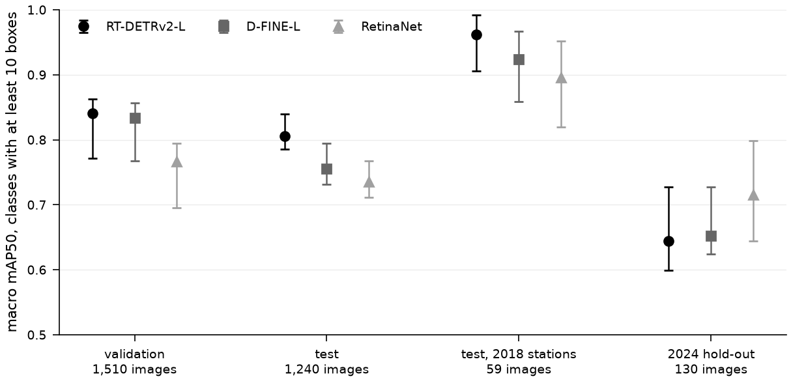

*Figure 1. Macro mAP50 of the three detectors on four sets of images, with 95 percent bootstrap intervals. RT-DETRv2-L is highest on the test images; on the 2024 hold-out the three lie within each other's intervals.*

### 3.8 The selected detector

RT-DETRv2-L at 1,024 pixels, first seed (`results/detector_summary/map50_by_slice.csv`, `ap50_by_class.csv`, `object_rules.csv`, `calibration.csv`). Macro mAP50 over the classes with at least ten boxes in the slice, with 95 percent bootstrap intervals over images:

| Slice | Images | Macro mAP50 |
|---|---|---|
| Test, all years | 1,240 | 0.806 [0.785, 0.840] |
| Test, 2017 | 25 | 0.779 [0.631, 0.873] |
| Test, 2018 | 59 | 0.962 [0.906, 0.992] |
| Test, 2020 | 79 | 0.624 [0.573, 0.716] |
| Test, 2022 | 717 | 0.753 [0.710, 0.797] |
| Test, 2023 | 360 | 0.880 [0.842, 0.917] |
| Test, 2020 to 2023 | 1,156 | 0.806 [0.777, 0.834] |
| 2024 hold-out | 130 | 0.644 [0.600, 0.743] |

Per-class AP50 with intervals, and the operating point of each class on the test split. The threshold applies to the calibrated score and is chosen on validation; precision and recall are those of the objects counted at that threshold.

| Class | Test boxes | AP50, test | AP50, 2018 test stations | AP50, 2024 hold-out | Threshold | Precision / recall, test |
|---|---|---|---|---|---|---|
| maurolicus | 805 | 0.97 [0.96, 0.98] | | | 0.33 | 0.93 / 0.96 |
| krill | 2,482 | 0.88 [0.85, 0.90] | | 0.78 [0.71, 0.86] | 0.33 | 0.87 / 0.85 |
| benthosema | 608 | 0.97 [0.96, 0.99] | 0.99 [0.94, 1.00] | | 0.43 | 0.95 / 0.95 |
| redfish | 14 | 0.90 [0.77, 1.00] | | | 0.92 | 0.76 / 0.93 |
| bluewhiting | 228 | 0.94 [0.92, 0.96] | | 0.89 [0.84, 0.93] | 0.41 | 0.87 / 0.87 |
| gelatinous | 96 | 0.72 [0.60, 0.83] | | | 0.50 | 0.82 / 0.62 |
| mackerel | 100 | 0.88 [0.81, 0.96] | 0.96 [0.90, 0.99] | | 0.27 | 0.70 / 0.94 |
| herring | 98 | 0.75 [0.57, 0.87] | 0.94 [0.87, 1.00] | | 0.87 | 0.85 / 0.68 |
| gonatus | 3 | 0.08 [0.00, 0.67] | | | 0.39 | none counted |
| sergestes | 82 | 0.70 [0.58, 0.84] | | | 0.34 | 0.66 / 0.70 |
| capelin | 170 | 0.85 [0.80, 0.90] | | 0.01 [0.01, 0.05] | 1.00 | none counted |
| pasiphaea | 62 | 0.49 [0.35, 0.68] | | | 0.32 | 0.68 / 0.37 |
| barracudina | 28 | 0.92 [0.81, 1.00] | | 0.26 [0.13, 0.47] | 0.07 | 0.87 / 0.93 |
| unidentified | 208 | 0.50 [0.42, 0.59] | | | 0.17 | 0.51 / 0.51 |

Capelin has no boxes in the validation split, so no operating threshold can be chosen for it and no capelin is counted; the 2024 hold-out holds one capelin box. Gonatus has three test boxes. The test AP50 of herring is lowered by the four herring boxes of the 2020 to 2023 slice (Section 3.4); on the 2018 test stations it is 0.94. The COCO mAP50:95 over all classes is 0.502 on the whole test split, 0.603 on the 59 images of the 2018 test stations and 0.264 on the 2024 hold-out.

Calibration. Over all validation detections above the score floor, the expected calibration error, cross-fitted by tow, is 0.075 for the raw scores and 0.019 after Platt scaling; on the 2018 validation stations it is 0.111 and 0.044.

The test figures carry a selection bias, because the choice between the two transformers used the test split (Section 3.7). The 2024 hold-out did not enter that choice.

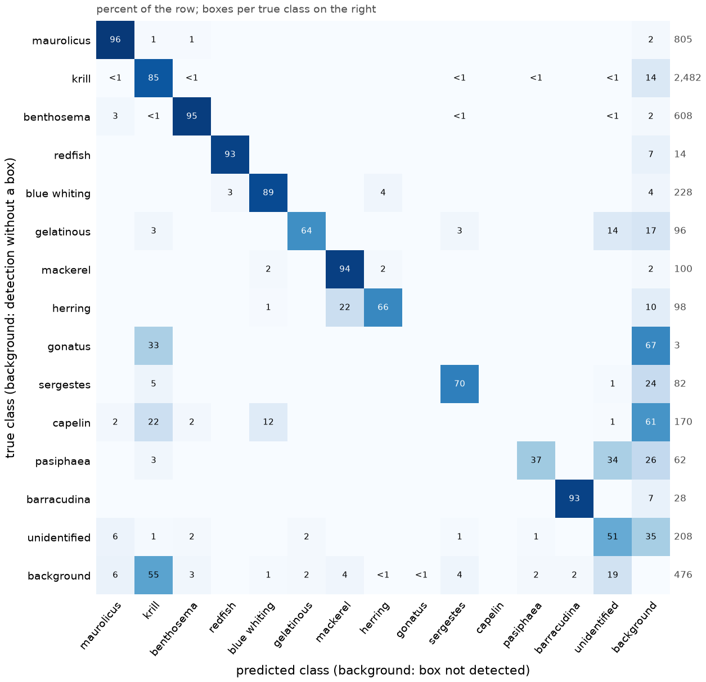

*Figure 2. Confusion matrix on the test split at the operating thresholds, in percent of each true class. The background row holds detections that match no box, and the background column holds boxes that were not detected. Herring is taken for mackerel in 22 percent of its boxes, and most false positives are krill.*

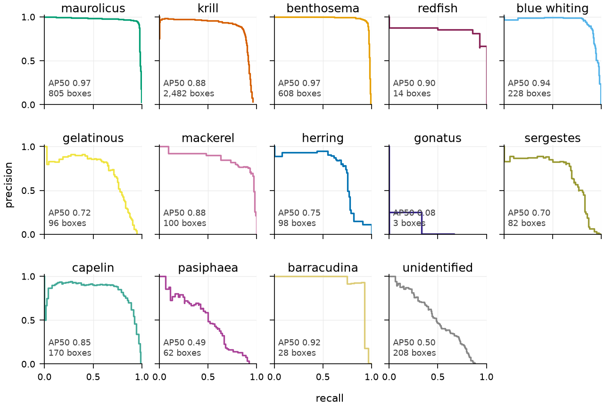

*Figure 3. Precision against recall per class on the test split, with the AP50 and the number of boxes of each class.*

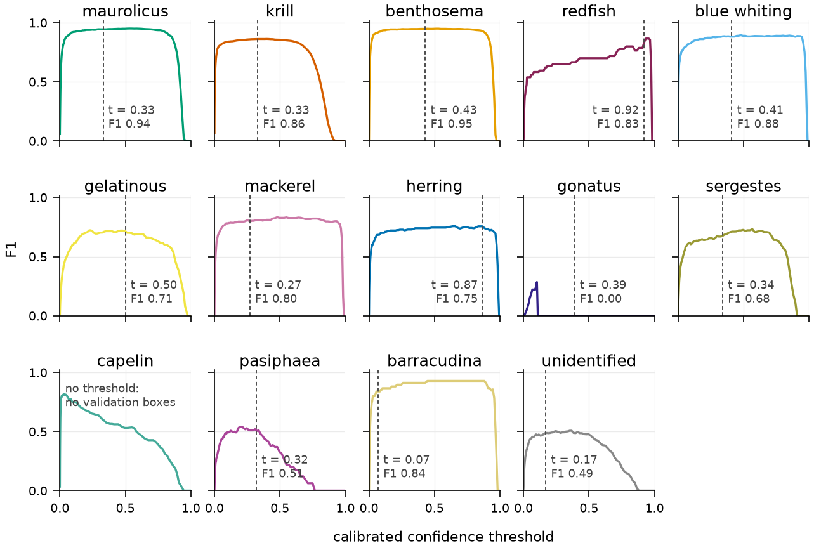

*Figure 4. F1 per class on the test split against the calibrated confidence threshold. The dashed line is the operating threshold chosen on validation. Capelin has no validation boxes and therefore no threshold.*

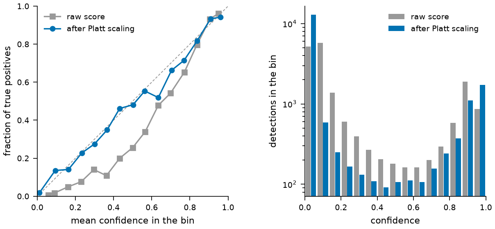

*Figure 5. Reliability of the confidence on the validation detections above the 0.05 floor, before and after Platt scaling. Left: the fraction of true positives per confidence bin; a calibrated detector lies on the diagonal. Right: the number of detections per bin.*

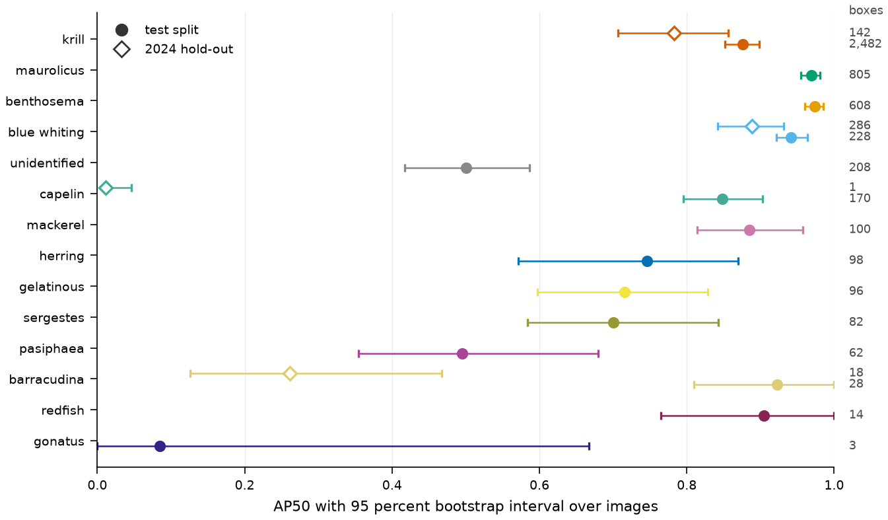

*Figure 6. AP50 per class on the test split (filled circles) and on the 2024 hold-out (open diamonds), with 95 percent bootstrap intervals. The numbers on the right are the boxes per class; classes are ordered by their test boxes.*

## 4. Transect inference

The selected detector (RT-DETRv2-L, 1,024 pixels, first seed) ran on the 141,727 left-camera frames of the four 2018 transects at 62 frames per second on one GPU, limited by JPEG decoding, and stored 5.3 million detections at the 0.05 floor. Per transect:

| Transect | Frames | Minutes | Detections at the floor | Frames without a detection at the floor | Frames without an object at the operating thresholds |
|---|---|---|---|---|---|
| 20180505T0637Z | 28,683 | 97 | 3,100,280 | 2.7 % | 45 % |
| 20180509T0018Z | 36,743 | 124 | 821,485 | 1.2 % | 68 % |
| 20180509T0805Z | 36,183 | 122 | 505,551 | 4.2 % | 67 % |
| 20180509T1938Z | 40,118 | 136 | 920,734 | 6.5 % | 57 % |

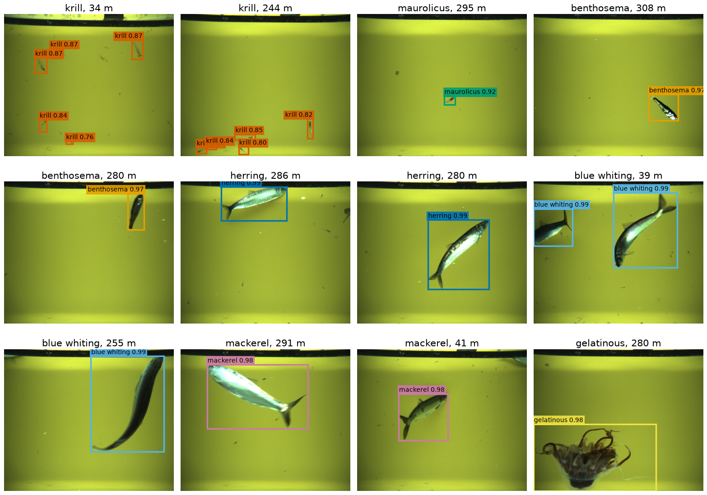

*Figure 7. Twelve frames from the 2018 transects with the objects counted by the selected detector. Each label gives the class and the calibrated confidence; each frame title gives the class shown and the camera depth. The frames are listed in `figures/gallery_frames.csv`.*

### 4.1 Fixed structure

While the camera is at the surface in daylight, its housing fills the top centre of the frame and the warp runs along the left edge. This happens at the start (2 to 4 minutes) and at the end (6 to 19 minutes) of every tow. The detector reports both in nearly every frame: the housing as benthosema or gelatinous, a bright speck near the lower right as maurolicus, and the warp as unidentified. The static filter of the methods (Section 3) finds five to eight such templates per transect; the housing recurs in up to 100 percent of the frames of the folders recorded at the surface. Objects at the operating thresholds before and after the filter:

| Transect | Benthosema | Gelatinous | Maurolicus | Unidentified | Krill |
|---|---|---|---|---|---|
| 20180505T0637Z | 3,178 to 199 | 56 to 30 | 1,667 to 1,105 | 2,041 to 790 | 158,416 to 158,400 |
| 20180509T0018Z | 5,373 to 544 | 480 to 56 | 1,622 to 733 | 853 to 853 | 7,625 to 7,625 |
| 20180509T0805Z | 4,664 to 2,313 | 1,460 to 94 | 2,229 to 1,532 | 808 to 806 | 11,120 to 11,119 |
| 20180509T1938Z | 6,731 to 760 | 167 to 166 | 4,516 to 2,146 | 1,277 to 1,277 | 34,436 to 34,431 |

Without the filter the benthosema series peaks at the surface at the start and end of every tow; those peaks are the housing, not fish, and benthosema is a minor class in the four tows. Frames with a static detection make up 11 to 15 percent of each transect (3,088; 4,872; 3,779; 5,973), and the camera intervals flagged as spent at the surface are 63, 102, 87 and 122 of 583, 746, 735 and 814.

### 4.2 Objects per transect

Resolved objects at the operating thresholds after the filter, main classes:

| Class | 20180505T0637Z | 20180509T0018Z | 20180509T0805Z | 20180509T1938Z |
|---|---|---|---|---|
| Krill | 158,400 | 7,625 | 11,119 | 34,431 |
| Herring | 30 | 11,567 | 7,354 | 8,999 |
| Benthosema | 199 | 544 | 2,313 | 760 |
| Maurolicus | 1,105 | 733 | 1,532 | 2,146 |
| Gonatus | 1,209 | 769 | 569 | 2,067 |
| Blue whiting | 61 | 945 | 809 | 881 |
| Mackerel | 282 | 75 | 34 | 81 |
| All classes | 162,180 | 23,205 | 24,701 | 51,073 |

The first transect is a krill tow at 25 to 40 m; the other three hold herring at 35 to 40 m (20180509T0018Z) and at 250 to 300 m (the two deep tows), with krill during the descents and ascents.

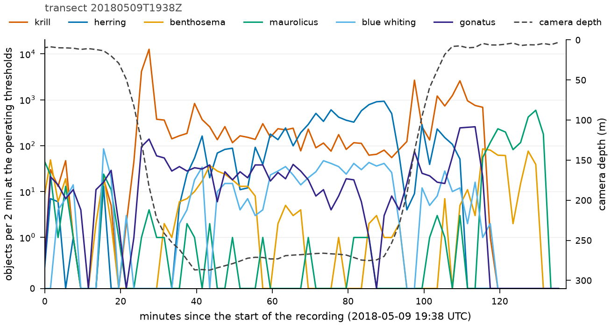

*Figure 8. Objects per two minutes for the main species along transect 20180509T1938Z, on a symmetric log scale, with the cleaned camera depth on the right axis. Krill dominates the descent and the ascent, herring the layer at 250 to 300 m, and maurolicus appears near the surface in the last twenty minutes.*

### 4.3 Frame-level review

Fifty frames per band of calibrated krill confidence and fifty frames with maurolicus at 0.3 or above were drawn per transect, after the static filter (`results/review`; the contact sheets are kept outside the repository). Krill at 0.6 and above is dense and unambiguous: elongated euphausiids, often dozens per frame. Between 0.3 and 0.6 the detections are sparse single animals of the same appearance, plausible but not verifiable at frame scale. Below 0.3 the detections are specks and bubbles. The operating threshold of 0.33 therefore sits at the boundary between the two usable bands. Maurolicus frames at 0.3 and above show single small fish; before the filter most of them were the housing speck.

### 4.4 Right camera

One folder of the fourth transect (2,000 frames, 6.8 minutes) was run through the right camera as well. After the filter the two cameras' object totals per ten seconds correlate at 0.82 (Spearman), and the right camera sees more small objects (krill 386 against 90, benthosema 128 against 79) in frames that are otherwise the same scene. The left camera remains the source of the counts, because the annotations that trained the detector are left-camera frames; the right camera is a consistency check.

## 5. Camera depth and time series

Detections join the metadata by frame timestamp with one unjoined frame per transect. The depth cleaning of the methods (Section 4) rejects 8.4, 2.1, 2.0 and 1.3 percent of the readings and marks 5.2, 7.9, 3.3 and 4.8 percent as dropouts. Every ten-second interval of the four transects (583, 746, 735 and 814) has a depth. The cleaned depth quantiles (5th, 50th, 95th percentile) are 3, 26 and 41 m; 6, 12 and 41 m; 4, 67 and 313 m; and 3, 192 and 284 m. By the static flag the camera is at the surface in 11 to 15 percent of the intervals. Confidence-weighted counts sum the calibrated scores of the resolved objects; the sum over every stored first hypothesis above the floor, which counts fractions of thousands of low-score hypotheses per minute, is kept as a diagnostic column only.

### 5.1 Camera depth

Camera depth per frame from the Deep Vision metadata, raw (exact zeros, which mark dropouts, removed) and after cleaning (Section 4 of the methods). Percentiles in metres.

| Transect | Frames | Dropouts | Raw 5th / 50th / 95th | Cleaned 5th / 50th / 95th |
|---|---|---|---|---|
| 20180505T0637Z | 28,682 | 5.2% | 2.4 / 27.1 / 53.5 | 3.2 / 25.5 / 40.7 |
| 20180509T0018Z | 36,742 | 7.9% | 3.2 / 21.5 / 53.5 | 5.6 / 12.0 / 40.7 |
| 20180509T0805Z | 36,182 | 3.3% | 3.2 / 87.8 / 317.8 | 4.0 / 67.1 / 313.0 |
| 20180509T1938Z | 40,117 | 4.8% | 2.4 / 224.4 / 289.1 | 3.2 / 192.4 / 284.3 |

The raw readings scatter upwards, so cleaning lowers the median by 2 to 10 m and the 95th percentile by up to 14 m. Two transects were towed near the surface throughout; the other two spent their first and last 20 to 30 minutes near the surface.

### 5.2 Depth cleaning check

The audit of the depth cleaner (methods, Section 4) shows the same signature in all four transects. Readings depart from the cleaned trajectory mostly to deeper values, by 13 to 14 m in the median regardless of depth, for a single sensor update (median interval 0.61 s) before returning. Departures to shallower values are rarer and smaller (about 7 m). The correlation between consecutive update steps is -0.5 in every transect, the mark of a spike that returns. No long departure is the sensor holding a stale value. The median residual of the accepted readings is zero in every band of vertical speed with the 30 s trend, so the trend neither lags the descent and ascent ramps nor leans to one side.

| Transect | Frames differing by more than 2 m / 10 m | Deeper / shallower than cleaned by more than 10 m | Single-update spikes deeper / shallower | Deeper excursion, median | Rejected deeper / shallower | Tolerance |
|---|---|---|---|---|---|---|
| 20180505T0637Z | 55% / 24% | 23.1% / 1.2% | 684 / 385 | 14.3 m | 2,390 / 28 | 16.7 m |
| 20180509T0018Z | 63% / 23% | 22.0% / 1.3% | 922 / 454 | 13.5 m | 775 / 0 | 22.7 m |
| 20180509T0805Z | 65% / 21% | 19.7% / 1.0% | 907 / 429 | 12.7 m | 717 / 0 | 22.7 m |
| 20180509T1938Z | 64% / 22% | 20.6% / 1.3% | 1,050 / 493 | 12.7 m | 516 / 0 | 27.0 m |

Rejections fall almost only on the deeper side because the rejection band is symmetric and only deeper readings leave it. Among readings more than 5 m from the trend in runs of ten or more frames, none to 0.2 percent are stale holds. Between 25 and 34 percent lie on the side a lagging trend would leave during a ramp, which is an upper bound, since deeper spikes also occur during descents. The rest are bursts of several changing values. Figures 9 to 12 show the cleaning of each transect.

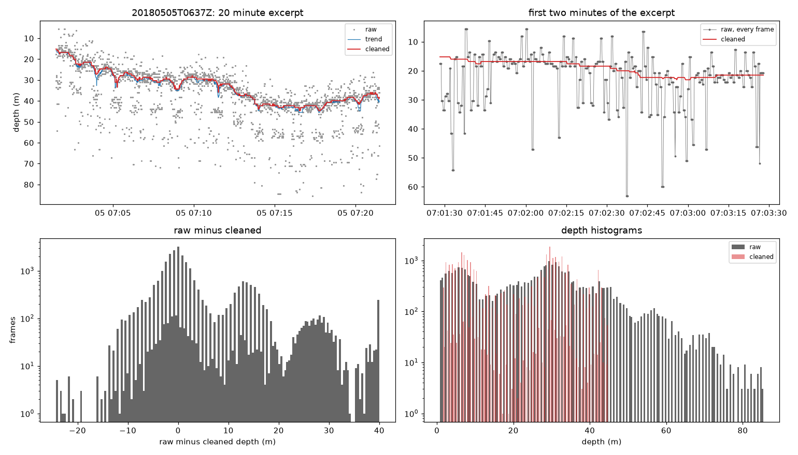

*Figure 9. Depth cleaning of transect 20180505T0637Z. Top left: twenty minutes of raw readings (grey), the trend (blue) and the cleaned depth (red). Top right: the first two minutes of that excerpt, frame by frame. Bottom left: raw minus cleaned depth over the whole transect. Bottom right: histograms of the raw and the cleaned depth.*

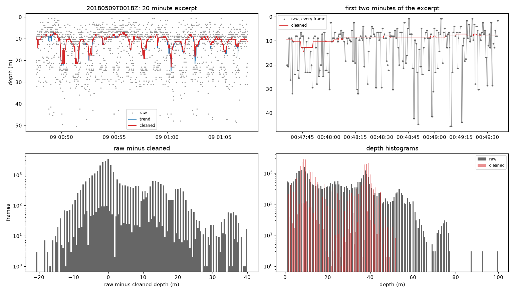

*Figure 10. Depth cleaning of transect 20180509T0018Z, with the same four panels as Figure 9.*

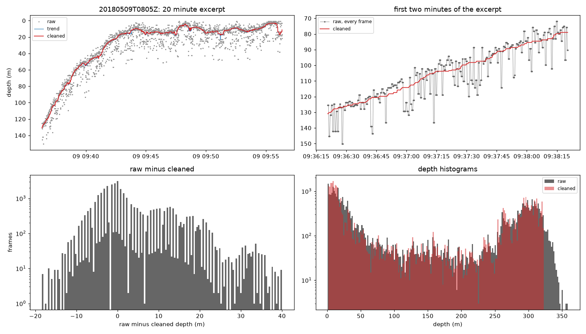

*Figure 11. Depth cleaning of transect 20180509T0805Z, with the same four panels as Figure 9.*

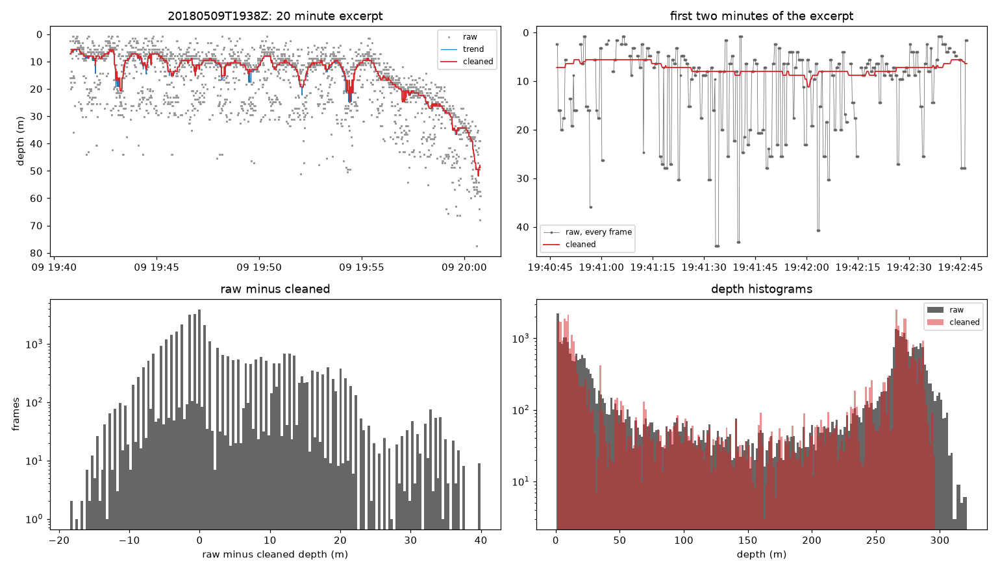

*Figure 12. Depth cleaning of transect 20180509T1938Z, with the same four panels as Figure 9. The raw readings scatter mostly to deeper values and return within one sensor update; the cleaned depth follows the descent to 50 m at the end of the excerpt.*
